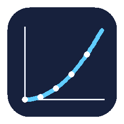
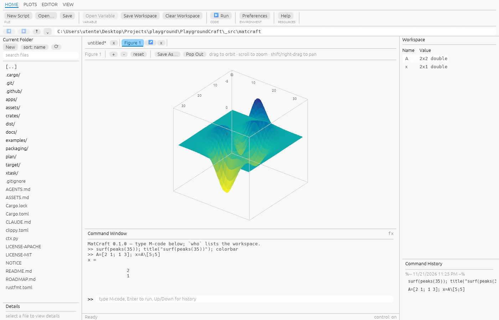
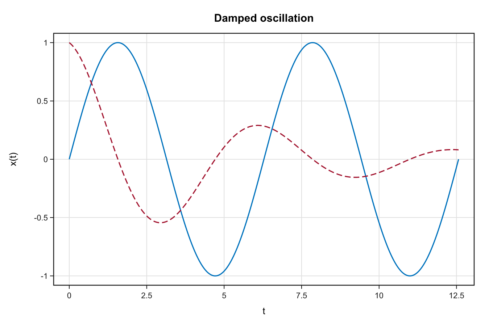
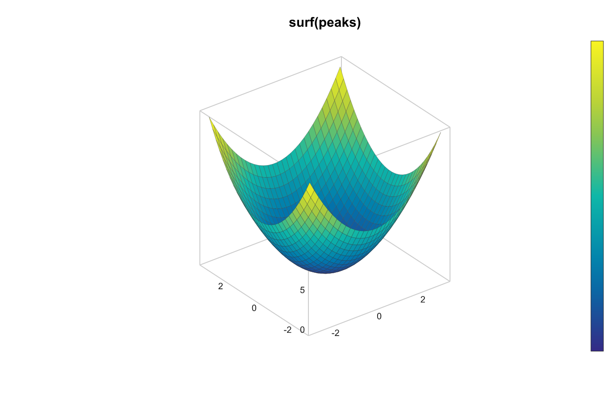
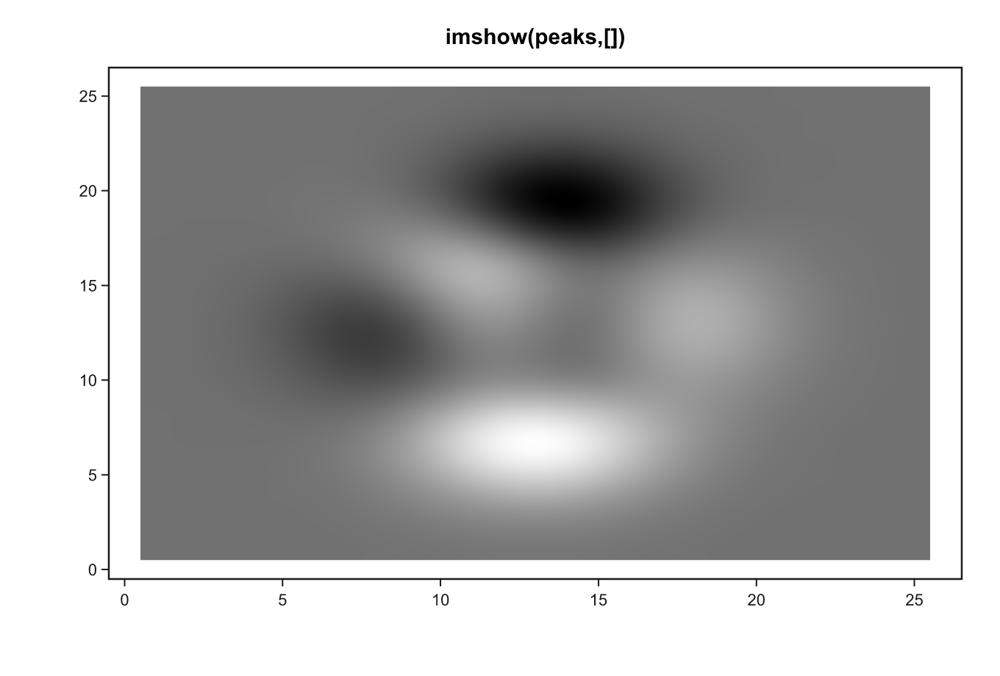
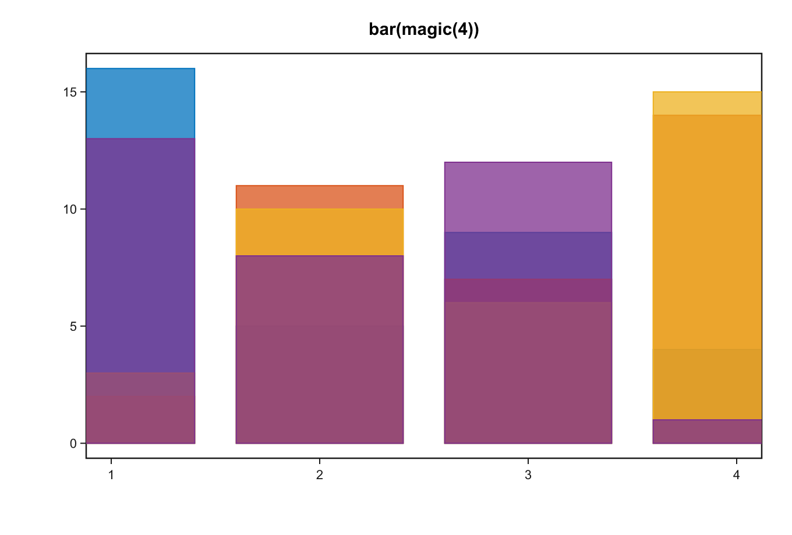

<p align="center">
  <a href="https://getartcraft.com/">
    <picture>
      <source media="(prefers-color-scheme: dark)" srcset="docs/brand/artcraft-logo-white.svg">
      
    </picture>
  </a>
</p>

<p align="center">
  
</p>

<h1 align="center">MatCraft</h1>

<p align="center">
  <b>A numerical-computing workbench; open source, agent-drivable, built in pure Rust.</b><br>
  An M-code-compatible environment: interactive Studio, headless CLI, language server,<br>
  and the simulation backbone for <a href="https://github.com/NibrasAz7/simcraft">SimCraft</a>.<br>
  macOS · Windows · Linux · FreeBSD · the web
</p>

<p align="center">
  
  
  
  
  <br>
  <a href="https://remade.wiki/projects/matcraft/"></a>
  <a href="https://idmo.app/playground/matcraft"></a>
</p>

<p align="center">
  <a href="https://discord.gg/artcraft"></a>
</p>

<p align="center">
  <a href="https://github.com/NibrasAz7/matcraft"><b>github.com/NibrasAz7/matcraft</b></a> ·
  <a href="https://getartcraft.com/">ArtCraft</a> ·
  <a href="https://getartcraft.com/apps">All Crafting Apps</a>
</p>

<br>

<p align="center">
  
  <br>
  <sub>The MatCraft Studio — an interactive <code>surf(peaks(35))</code> in the wgpu viewport, with the command window and workspace.</sub>
</p>

> [!NOTE]
> **ArtCraft is a community of artists from all walks of life.** Digital, generative, music,
> games &mdash; if you make things, you're one of us. **[Come say hi on Discord](https://discord.gg/artcraft).**

<p align="center">
  <a href="#highlights">Highlights</a> ·
  <a href="#a-look-around">A look around</a> ·
  <a href="#the-interfaces">Interfaces</a> ·
  <a href="#quick-start">Quick start</a> ·
  <a href="#the-layout">Layout</a> ·
  <a href="#whats-next">What's next</a> ·
  <a href="#the-crafting-apps">The Crafting Apps</a> ·
  <a href="#license-and-assets">License</a>
</p>

---

## Community

MatCraft is part of [ArtCraft](https://getartcraft.com). Come say hello, get help and follow development:

- **Discord: [discord.gg/artcraft](https://discord.gg/artcraft)** — the fastest way to get help and share feedback.
- **Source:** [github.com/NibrasAz7/matcraft](https://github.com/NibrasAz7/matcraft)
- **Sibling simulator:** [github.com/NibrasAz7/simcraft](https://github.com/NibrasAz7/simcraft) — Simulink-style models that run inside MatCraft.

The ArtCraft name and logos in `docs/brand/` are trademarks of the ArtCraft Team and are not open source. They may be used only unmodified, and only as part of MatCraft (see `docs/brand/LICENSE-brand.txt`). Forks and modified versions must remove them.

## Highlights

<table>
<tr>
<td width="33%" valign="top">

### Familiar
Real M-code: column-major matrices, cell arrays, structs, function files, `end`-indexing, grow-on-assign — the semantics you expect, not approximations.

</td>
<td width="33%" valign="top">

### Fast and honest
A bytecode-compiled loop tier under the tree-walk interpreter, a feature-gated `faer` backend for matmul/SVD/eig, and complex eigendecomposition — while the default stays pure Rust and wasm-clean.

</td>
<td width="33%" valign="top">

### Yours, and your agent's
Every interface is headless-reachable: CLI, stdio LSP, newline JSON-RPC MCP, a TCP control channel, and the SimCraft engine bridge. No account, no telemetry, no cloud.

</td>
</tr>
</table>

---

## A look around

|                                  |                                 |                                    |                                |
| -------------------------------- | ------------------------------- | ---------------------------------- | ------------------------------ |
|  |  |  |  |

<sub>`plot`/`loglog` with styled lines · `surf` in the interactive wgpu viewport · `imshow` of a complex field · `bar`/`histogram` — all produced by the headless `matplot` pipeline.</sub>

- **Interactive 3-D figures.** `surf`, `mesh` and `plot3` open in a real wgpu viewport — orbit, zoom and pan on the GPU, with colormap shading and axes.
- **The language is real.** ~750-file public M-code corpus run as a live test target; `eig` returns complex eigenpairs, `A\b` does least-squares, `loadlibrary`/`calllib` reaches plain-C libraries.
- **Figures are data.** The same `matplot` pipeline serves the Studio, the CLI (`saveas` → PNG/SVG/PDF) and SimCraft scopes.

## The interfaces

Every surface reaches the same engine session — drive it from wherever you work.

| Interface          | What it gives you                                                                                                      |
| ------------------ | ---------------------------------------------------------------------------------------------------------------------- |
| `matcraft` Studio  | egui + wgpu desktop app — ribbon, command window, workspace/figure docks, interactive 3-D viewport, live editor hints     |
| `matcraft-cli`     | `eval`, `run`, `repl`, `functions` — script and shell use                                                                 |
| `matcraft-cli lsp` | stdio language server — parse diagnostics, builtin completion/hover, document symbols; point any editor at it             |
| MCP server         | newline-delimited JSON-RPC 2.0 on stdio — `execute`, `eval`, `run_script`, command listing, `matcraft://workspace`        |
| Control channel    | TCP JSON-lines when the Studio runs with `--control` — `engine.execute`, `ui.state`, `ui.render`, `ui.screenshot`          |
| SimCraft bridge    | `sim.run`, `sim.check`, `model.set_param` — block-diagram simulation inside your session, scopes land as matplot figures   |

## Quick start

```console
cargo run -p matcraft-cli -- repl                    # interactive session
cargo run -p matcraft-cli -- run examples/solve.m    # run a script
cargo run -p matcraft-cli -- eval "A = [1 2; 3 4]; det(A)"
cargo run -p matcraft-cli -- functions               # the builtin library
cargo run -p matcraft-cli -- lsp                     # stdio language server
cargo run --release -p matcraft                      # the Studio (--control 7979 for TCP)
```

## The layout

| Crate              | Role                                                                                            |
| ------------------ | ----------------------------------------------------------------------------------------------- |
| `crates/matcore`   | L0 — column-major `f64`/`complex`/`sparse` matrices, pure-Rust linalg, optional `faer` backend     |
| `crates/matffi`    | L0 — `loadlibrary`/`calllib`/`libpointer` FFI into plain-C DLLs (the only `unsafe` boundary)       |
| `crates/matlang`   | L1 — lexer, parser, interpreter (tree-walk + bytecode loop tier), builtins, signature metadata     |
| `crates/matplot`   | L2 — figure model, headless SVG/PNG/PDF renderer, 3-D projection                                  |
| `crates/engine`    | L5 — command/session layer; every user-visible behaviour is a command id                           |
| `crates/lsp`       | L6 — language-server protocol on stdio                                                            |
| `crates/jupyter`   | L6 — Jupyter kernel core (wire + semantics; ZMQ transport is a follow-up)                          |
| `crates/ui-egui`   | L6 — Studio UI: ribbon, docks, wgpu figure viewport, editor                                       |
| `crates/mcp`       | L6 — MCP server                                                                                   |
| `apps/*`           | L7 — `matcraft` Studio, `matcraft-cli`, web shell                                                  |

`cargo xtask layers` enforces the stack — nothing below L6 touches egui/wgpu/winit.

## What's next

`ROADMAP.md` is the one-page summary: headline numbers, progress log, the honest compatibility story. `docs/gaps.md` ranks the remaining work — Cranelift JIT for loop hotspots, the Jupyter ZMQ transport, broader plotting/toolbox coverage.

## The Crafting Apps

MatCraft is one of the ArtCraft family — original, clean-room, Rust-native tools. Its numerical sibling is [SimCraft](https://github.com/NibrasAz7/simcraft): block-diagram simulation wired into this workspace.

## License and assets

MIT OR Apache-2.0. Every non-code file is original, open-licensed or generated by the project and is tracked in `ASSETS.md`; the ArtCraft marks in `docs/brand/` are trademarked under `docs/brand/LICENSE-brand.txt`. No proprietary code, artwork or data ships in this repository.
